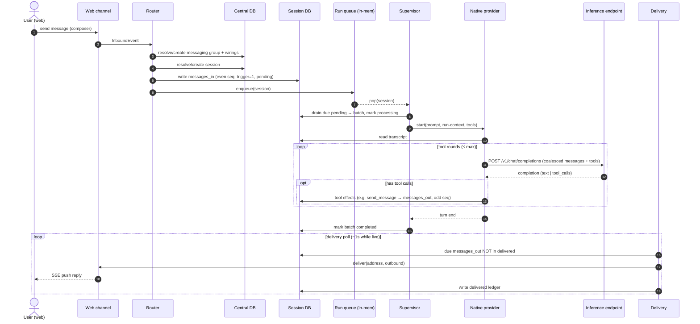
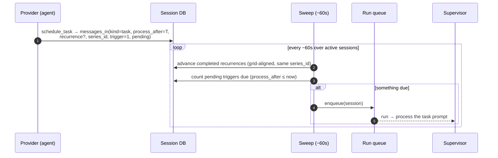
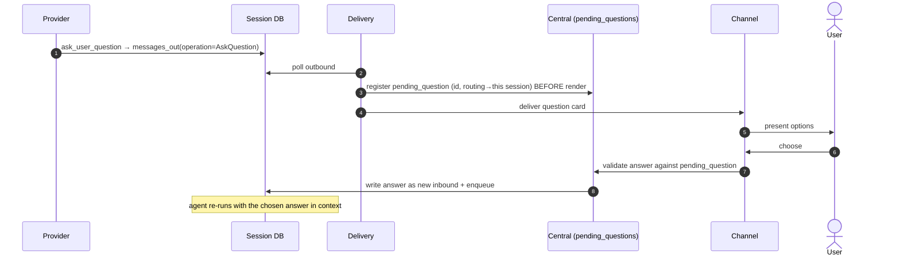

# claw — System Specification

> **Status:** base document for a rewrite. Describes *what the system does and the
> contracts it must honour*, deliberately implementation-agnostic (no language or
> crate names except where a contract depends on one). Derived from the running
> system and `ARCHITECTURE.md`; refine freely. Where the current build has scars,
> they are called out under **§17 Lessons** so the rewrite doesn't reinherit them.

---

## 1. Purpose

claw is a **single-binary personal AI-assistant daemon**. One process hosts:

- a built-in **web UI + HTTP API** (the primary surface),
- one or more **external messaging channels** (today: SMS via a sidecar; the seam
  generalizes to Telegram/WhatsApp/etc.),
- an in-process **agent runtime** that drives any OpenAI-compatible chat-completion
  endpoint, with tools,
- **scheduling** (one-shot + recurring) and **resilience** (retries, watchdog,
  crash recovery),
- an **admin command registry** that backs both a CLI and the web admin.

The organizing idea: **everything between the outside world and the agent is rows
in SQLite.** Channels write inbound rows; the agent reads them and writes outbound
rows; a delivery loop ships outbound rows back to channels. The DB *is* the message
bus, the queue, and the audit log.

### Goals
- Small enough to understand end-to-end: one deployable unit, one persistent volume.
- Customization = editing the code, not config sprawl.
- Predictable: sequential agent execution, explicit state machines, pure decision
  functions, `Result`-style error handling everywhere.
- Self-hostable: bring your own inference endpoint; one volume holds all state.

### Non-goals
- **Inter-agent OS isolation.** Agents share the process's filesystem; the only
  boundary is the container around the whole daemon (§14).
- **Concurrent agent runs.** Strictly sequential is a feature (predictable load, no
  warm-pool or per-claim arbitration).
- **Heavyweight platform SDKs in-tree.** A channel that needs a vendor SDK or a
  second language runtime is out of scope; channels whose transport is a plain
  authenticated HTTP API are in scope.

---

## 2. System model

```
            ┌──────────── one daemon process ────────────┐
 outside →  │  channels →  ROUTER → [central DB] → QUEUE  │
 world      │                          │            │     │
            │                          ▼            ▼     │
            │                    [session DBs]  SUPERVISOR │  → inference endpoint
            │                          ▲            │     │     (OpenAI-compatible)
            │  channels ← DELIVERY ←───┘────────────┘     │
            │                    SWEEP (timers/recurrence) │
            └─────────────────────────────────────────────┘
                         everything persists under one data dir
```

The daemon is **stateless outside its data directory**. Upgrade = new binary, same
directory. The pipeline stages (router, queue, supervisor, delivery, sweep) are
independent long-running tasks that communicate only through the databases (plus an
in-memory wake-up queue, §6).

---

## 3. Domain model

Two tiers of storage:

- **Central DB** — all entities and routing/config (one file).
- **Per-session DBs** — one SQLite file per conversation session, holding only that
  session's message ledger (§5).

### Entities (central DB)

| Entity | Meaning |
|---|---|
| **endpoint** | An OpenAI-compatible inference target: base URL + API key (inline or env-var ref). |
| **agent group** | "An agent": name, folder (its workspace), provider kind, endpoint, model, tool profile, CLI scope. The unit an inbound is routed *to*. |
| **messaging group** | A conversation on a channel, keyed by `(channel_type, platform_id)`. Auto-created on first contact. May be a group chat or a DM; carries an unknown-sender policy and an archived flag. |
| **wiring** (`messaging_group_agents`) | Binds a messaging group to an agent group, with engage mode, engage pattern, sender scope, ignored-message policy, session mode, priority. The explicit routing edge. |
| **connector** | An external channel instance as data: `kind` (unique), label, typed config (JSON), assigned agent group, enabled flag. One row = one channel = one assigned agent. Adapters are built from enabled rows at startup. |
| **session** | A live conversation thread for `(agent group, messaging group, optional thread)`. Points at a per-session DB. Has status (active/closed). |
| **user / user_roles / agent_group_members** | Identity + RBAC (owner, admin; global or per-group). |
| **user_dms** | Resolves a user to their DM messaging group per channel. |
| **pending_question** | An open multiple-choice question awaiting an answer from any surface; carries routing back to the originating session. |
| **pending_approval** | A privileged command held for owner approval; carries the command + args + routing. |
| **dropped_messages** | Audit log of inbounds that matched no routing. |
| **web_messages** | The web channel's transcript/ledger (chat + question/approval cards). |
| **channel_cursors** | Per-channel inbound poll position (e.g. SMS `after_seq`). |
| **schema_version** | Numbered migration bookkeeping. |

### Relationships
- An **inbound** arrives on a `(channel_type, platform_id)` → resolves to a
  **messaging group** → fans out to its **wirings** → each yields a **session** for
  an **agent group**.
- If a messaging group has **no explicit wirings**, routing falls back to the
  **enabled connector** for that channel type and targets its assigned agent group
  (the connector row *is* the default assignment). Explicit wirings always win.

### Value enums (the domain's vocabulary)
- **MessageKind**: chat | task | webhook | system.
- **MessageStatus**: pending | processing | completed | failed | paused.
- **SessionMode**: shared | per-thread.
- **EngageMode**: pattern | mention | mention-sticky.
- **AgentProviderKind**: native | echo.
- **ToolProfile**: chat | coder.
- **CliScope**: disabled | group | global.
- **ConnectorKind**: sms (extensible).
- **Role**: owner | admin.
- **UnknownSenderPolicy**: strict | request-approval | public.
- **SenderScope**: all | known. **IgnoredMessagePolicy**: drop | accumulate.

---

## 4. Storage: central DB

One file, numbered forward-only migrations, WAL, single pooled connection behind a
synchronous access layer (DB calls must never block the async runtime — offload to a
blocking pool). All access is value-typed (newtype ids, enum columns), never
stringly-typed at the boundaries.

---

## 5. Storage: per-session DB (the message ledger)

Each session is one SQLite file with a fixed schema. **This is the core contract of
the whole system** — the agent and the host communicate only through it.

### Tables
- **messages_in** — inbound to the agent. `id, seq, kind, timestamp, status,
  process_after, recurrence, series_id, tries, trigger, platform_id, channel_type,
  thread_id, content (JSON), source_session_id`.
- **messages_out** — the agent's outbound. `id, seq, in_reply_to, timestamp,
  deliver_after, recurrence, kind, platform_id, channel_type, thread_id,
  content (JSON)`.
- **delivered** — delivery ledger: `message_out_id, platform_message_id, status,
  delivered_at`. The idempotency guard for outbound.
- **session_routing** — the session's *default* routing (single row): the address
  replies go to when an outbound doesn't specify its own.
- **destinations** — optional named/allowlisted send targets.

### Invariants (must be preserved by any rewrite)
1. **Seq parity.** The host writes **even** `seq` into `messages_in`; agent runs
   write **odd** `seq` into `messages_out`. A single monotonic sequence interleaves
   both directions and gives a total order for the transcript. Violating parity
   corrupts ordering.
2. **Status lifecycle.** `messages_in`: pending → processing → completed | failed |
   paused. A run claims a batch by moving pending→processing; on success →completed,
   on exhaustion of retries →failed. **A run cannot outlive its supervising process**
   — on startup, any `processing` left by a crash is reset to `pending` (crash
   recovery).
3. **Trigger vs accumulate.** `trigger=1` means this inbound should *wake* the agent
   (enqueue a run); `trigger=0` means it accumulates silently and rides along on the
   next run. The engage decision (§7) sets this.
4. **Scheduling fields.** `process_after` (ISO-8601 UTC) gates when an inbound becomes
   due; `recurrence` (cron) + `series_id` define repeats; `deliver_after` does the
   same for outbound.
5. **At-least-once, not exactly-once.** Inbound routing and outbound delivery are
   at-least-once; the `delivered` ledger dedupes outbound, and message content is
   the natural idempotency key for inbound where a channel can replay.

---

## 6. The message pipeline

Five cooperating loops. State flows only through the DBs plus one in-memory
**run queue** (a FIFO + dedup set; a wake-up signal, not a store of record).

### 6.1 Router (inbound)
Consumes `InboundEvent {channel_type, platform_id, thread_id, kind, content,
is_mention, is_group}` from channels. For each event:
1. Resolve/auto-create the messaging group for `(channel_type, platform_id)`.
2. Find its wirings; if none, fall back to the enabled connector's agent (§3).
3. If still no target → record a **drop** ("no-wiring") and stop.
4. For each target: resolve/create the session (shared vs per-thread), persist the
   session's default routing, write the inbound row (even seq) with `trigger` set by
   the **engage decision**, and — if engaging — enqueue the session for a run.

### 6.2 Engage decision (pure function)
Given `(is_chat, is_group, is_mention, sticky, mode, pattern, text)` → **Run** or
**Accumulate**. Non-chat kinds and direct messages always Run. Group chats consult
the wiring's mode: pattern (case-insensitive substring), mention, or mention-sticky.
This function must stay pure and table-tested.

### 6.3 Run queue + supervisor
- The queue is **sequential by construction**: one run at a time, dedup by session.
- The supervisor pops a session, drains its **due pending** inbound into a batch
  (respecting `process_after`), marks them `processing`, and invokes the agent
  provider. On clean completion → mark the batch `completed`. On failure → retry
  with backoff (increment `tries`, reschedule `process_after`), and after a cap →
  `failed`.
- The supervisor injects **run context** (§8) and surfaces lifecycle signals to an
  in-memory **activity hub** (for the admin "mission control" view) and a per-chat
  presence notifier — both best-effort and side-effect-free w.r.t. the run.

### 6.4 Delivery (outbound)
Polls `messages_out` for due, undelivered rows (fast while a run is live for the
session, slow sweep otherwise). For each:
- **Agent-to-agent** (`channel_type='agent'`): inject into the target group's session
  as a new inbound + enqueue (delegation). **Agent-return** (`'agent-return'`):
  inject into the originating session + enqueue (so the concierge relays the result).
- **system** kind: run the action registry.
- Otherwise: resolve the address (message routing wins field-by-field, falling back
  to session default routing), register any **question/approval** centrally *before*
  rendering, then hand to the channel adapter's `deliver`. On success → write the
  `delivered` ledger row + clean up staged attachments. 3 attempts → mark failed.

### 6.5 Sweep (timers)
Every ~60 s, over each active session: advance due **recurrences** (grid-aligned via
an in-house cron evaluator, same `series_id`), and enqueue sessions whose scheduled
triggers have come due. Also expires unanswered questions past their TTL, and runs
the **watchdog** (§10).

---

## 7. Channels & connectors

### 7.1 The adapter seam
A **channel adapter** is the plugin boundary. Contract:
- `channel_type()` — stable string id.
- `supports_threads()`.
- `run(inbound_sink, cancel)` — long-running; pushes `InboundEvent`s until cancelled.
  Reconnect/backoff is the adapter's business.
- `deliver(address, outbound)` — ship one outbound; returns an optional platform
  message id. Optional `set_typing` / `edit` / `react` (default: unsupported).

Adapters are looked up by `channel_type` at delivery time. The pseudo-channels
`agent` / `agent-return` never reach an adapter (handled in delivery, §6.4).

### 7.2 Web channel (always present)
Bridges the HTTP/SSE UI to the router and delivery: inbound from the composer →
router; outbound → web ledger + SSE push. Richest surface (questions as cards,
approvals, attachments, file browser). The baseline every other channel degrades from.

### 7.3 Connectors (external channels as data)
A connector is one enabled row (§3) → one adapter built at startup. Per-kind typed
config; an exhaustive match over `ConnectorKind` builds the adapter, so adding a kind
is a compile-time todo list. **The assignment lives in the connector row** — reassign
the agent there and the whole channel moves, with no per-conversation wiring churn.

### 7.4 SMS connector (the reference external channel) — contract with the sidecar
SMS is provided by a **sidecar HTTP service** ("sim-server") that owns a GSM modem.
claw is a pure client of its API. The contract claw depends on:

- **Inbound = cursor polling.** `GET /api/messages?after_seq=N` returns messages with
  a **persistent, monotonic, never-reused `Seq`** (oldest-first). claw stores the
  cursor in `channel_cursors`, advances it **per message after routing**
  (at-least-once; replay window = one message on crash). First run takes the current
  high-water mark *without routing* (no history flood). A `Seq`-less message is routed
  but never advances the cursor; blank content is skipped.
- **Wake-up webhook (latency optimization only).** The sidecar POSTs a signed ping
  (`HMAC-SHA256` of the raw body with a shared secret) to claw's hook endpoint; claw
  verifies it (constant-time) and triggers an *immediate* poll. The hook carries **no
  message data** — a lost/duplicated/forged-then-rejected hook changes nothing;
  polling is the source of truth. No connector/secret configured → the hook 404s.
- **Outbound.** `POST /api/messages {phone, content}`; 10 s timeout; non-2xx →
  retryable delivery error. Sidecar concatenates long messages and handles encoding.
- **Sidecar-side guarantees claw relies on:** `Seq` stability across restarts, a
  reasonable retained-history window, and that *received* messages reliably enter the
  cursor stream even if a live modem announcement is missed (the sidecar must
  reconcile its store with the SIM periodically, not only react to live events).

### 7.5 Outbound rendering & the GSM-7 reality
Outbound content is flattened to the single plain-text string a channel can carry.
For SMS specifically: interactive operations degrade (a question rides as its text;
an approval becomes "approve in the web admin" — an SMS sender is spoofable, never an
authorization channel; attachments become a "[N not deliverable]" note). Text is
folded to a 7-bit-safe subset **unless** the transport encodes Unicode itself — see
**§17** for why this matters.

---

## 8. Agent providers (the agent)

### 8.1 Provider contract
A provider is invoked with a `QueryInput`: prompt (the drafted batch), workspace dir,
session dir, model, **system context**, resolved inference (endpoint+key), tool
profile, optional admin handle, optional MCP client, optional SMS access. It streams
lifecycle/progress events and, crucially, **writes its own outbound rows** (via tools
or a fallback) — a successful turn returns no text for the host to write.

Two providers: **echo** (no network, for tests/bootstrap) and **native** (the real
agent).

### 8.2 Native provider — the chat-completion loop
1. Build the system prompt = **run context** (current local + UTC time, so the model
   can schedule against a real clock) ahead of the group's `AGENT.md`.
2. Build the message list from the session **transcript** (newest-first within a token
   budget, then re-ordered oldest-first), mapping inbound→user / outbound→assistant.
   **Consecutive same-role messages must be merged** so the request is well-formed
   (see §17).
3. Loop up to a max number of tool rounds: call the endpoint with the message list +
   tool definitions; if no tool calls, treat the text as the reply (fallback writes
   it) and finish; otherwise append the assistant tool-call message + each tool result
   and continue.
4. **Idempotency under retry:** once the agent has produced a reply this turn, a later
   round failing must *not* fail the whole turn (which would re-run and double-send) —
   the reply is already out; treat the turn as done (§17).

Memory is the session DB itself; intermediate tool rounds within a turn are *not*
persisted (a known limitation — a later turn re-derives state).

### 8.3 Tool surface (by profile + context)
- **Messaging (all agents):** `send_message`, `schedule_task`, `list_tasks`,
  `cancel_task`, `pause_task`, `resume_task`, `send_to_agent`, `ask_user_question`.
- **Coder profile adds:** `bash` (workspace cwd, timeout, output truncation),
  `read`, `write`, `edit`.
- **When CLI scope permits:** `admin` (run an admin command as this agent, scope-gated).
- **When an SMS connector is enabled:** `send_sms(to, text)` (sends via the channel
  delivery path — reuses retries/rendering), `read_sms(limit)` (reads the sidecar inbox).
- **When an MCP server is connected:** its tools, namespaced `<server>__<tool>`, for
  every agent (today: a web-search server exposing `search`/`fetch`/`screenshot`/
  `interact` over a headless browser).

### 8.4 MCP integration
claw spawns a stdio MCP server child, handshakes, lists its tools, and exposes them to
agents namespaced. Tool calls round-trip through claw to the child. Best-effort: if the
server can't spawn, agents simply run without those tools. (Caveat: the bundled
web-search server drives a headless browser, which needs its system libraries present.)

### 8.5 Endpoint & model resolution
An agent group resolves to an endpoint (its own, or a default) → base URL + key +
model. Keys come from inline config or env-var references; no credential proxy. The
**context budget must fit the endpoint's context window** (§17).

---

## 9. Scheduling & resilience

- **schedule_task(prompt, process_after?, recurrence?)** writes a future inbound (task
  kind) into the session, optionally recurring (validated cron). `list/cancel/pause/
  resume` manage them by `series_id`.
- **Sweep** advances recurrences and enqueues due tasks (§6.5).
- **Backoff:** failed runs reschedule with increasing delay up to a try cap, then fail.
- **Watchdog:** detects stuck/over-running runs.
- **Crash recovery:** `processing`→`pending` reset on startup; the in-memory queue is
  rebuilt from due pending state.
- **Circuit breaker:** persisted, to back off a flapping subsystem across restarts.

---

## 10. Web interface & API

- **Auth:** single shared login token → HttpOnly session cookie. One protected router
  behind an auth middleware; a small public surface (login, health, static assets, and
  the SMS wake-up hook whose HMAC *is* its auth).
- **Surfaces:** chat list + per-chat view (SSE-streamed), composer, message history,
  question cards + answer, approval cards + answer, per-chat agent **file browser**
  (jailed to the agent workspace), an **admin** section, a **tasks** page, a **logs**
  viewer (live ring buffer over SSE), and an **activity** board ("mission control":
  per-agent status + feed + sidebar presence).
- **No build step:** server-rendered templates + hand-written CSS/JS, assets embedded
  in the binary. 100% one runtime — no second language toolchain.

---

## 11. Admin command registry (one source, two surfaces)

Admin operations are defined **once** as command definitions (name, resource, access
level, typed arg specs with display metadata, handler). From this single registry:
- the **CLI** (`claw <resource> <verb> --k v`, spoken over a unix socket to the daemon)
  and
- the **web admin** (nav + CRUD forms rendered from the arg specs)
are both generated. Adding a resource = adding its command defs; the web admin updates
for free.

Access levels: open | approval (an agent invoking it is held for owner approval) |
hidden (operator-only). Current resources: endpoints, agent groups, wirings,
connectors, roles.

---

## 12. Configuration

Environment only, minimal: data dir, port, auth token, timezone, default endpoint,
default model. Per-channel/connector config lives in the DB (connector rows), not env.
Everything else is code. Secrets (inference keys, connector tokens, webhook secrets)
are write-only through admin surfaces — never echoed back.

---

## 13. Observability

- Structured single-line logs to stderr + a durable file; `WARN+` duplicated to an
  error log. An in-memory ring buffer feeds the live admin log viewer.
- The **activity hub** holds per-agent run state + a bounded event feed, updated at run
  lifecycle points, broadcast to the admin board. In-memory, optional, never affects a
  run's result.
- Tool subprocess stderr is captured into tool results and logs — agent failures are
  never silently lost.

---

## 14. Security model (stated plainly)

- **No inter-agent isolation.** A coder agent's `bash` runs as the daemon user on the
  daemon's filesystem; it can read other sessions' data and the binary. Workspace cwd,
  tool profiles, and prompts scope by convention, not enforcement. The container around
  the whole daemon protects the *host*, not sessions from each other.
- **Approval gates / CLI scope are intent checks**, not security boundaries.
- **Single-user auth** on the only network surface.
- **Channels widen reach.** Once a connector is assigned, anyone who can reach that
  channel (e.g. knows the SIM's number — and SMS sender identity is spoofable) can talk
  to the agent. Treat external channels as untrusted input, never authorization.
- The claw↔sidecar link is assumed to be a trusted LAN/localhost hop; the one
  unauthenticated POST (the wake-up hook) is HMAC-gated and carries no data.

---

## 15. External integration contracts (summary)

| Dependency | Contract claw relies on |
|---|---|
| **Inference endpoint** | OpenAI-compatible `/v1/chat/completions` with tool-calling; a context window ≥ claw's budget; standard error bodies (esp. context-size + message-shape errors surfaced as 4xx). |
| **SMS sidecar** | `after_seq` cursor (persistent/monotonic `Seq`), `POST /api/messages`, HMAC wake-up webhook, periodic SIM reconciliation so no inbound is lost. (§7.4) |
| **MCP server(s)** | stdio JSON-RPC: initialize → tools/list → tools/call. Bundled web-search server needs a working headless browser + its system libs. |

---

## 16. What the rewrite should preserve vs. reconsider

**Preserve (these are the good bones):**
- DB-as-message-bus with the per-session ledger and the seq-parity contract.
- The five-stage pipeline with a sequential run queue.
- The channel-adapter seam + connectors-as-data with routing fallback.
- The command registry as the single source for CLI + web admin.
- Pure, table-tested decision functions (engage, backoff, recurrence, rendering).
- Connector cursor semantics (at-least-once, first-run skip) and the hook-as-ping.

**Reconsider (open questions for the rewrite):**
- **Tool-round persistence.** Intermediate tool calls/results aren't in the transcript,
  so cross-turn state is re-derived. Worth persisting?
- **Context budget vs. endpoint window.** Today a fixed budget can exceed a small
  `n_ctx`. Make it endpoint-aware or adaptively truncate on overflow.
- **Turn idempotency / partial completion.** A turn that sends a reply then fails is a
  real case; model it explicitly (a turn is a sequence of committed effects, not all-
  or-nothing) rather than patching the retry path.
- **Exactly-once inbound.** Currently at-least-once with content-fingerprint dedup at
  the sidecar; consider a stable per-message id end-to-end.
- **Multi-instance connectors.** `kind` is unique today (one SIM, one bot). Generalize
  if multiple instances per channel are wanted.

---

## 17. Lessons (bugs the current build hit — the rewrite must handle these by design)

1. **Chat requests must be well-formed.** The transcript can contain two assistant
   turns in a row (the agent sent two replies, or a retry rewrote one); mapped 1:1 this
   produces consecutive assistant messages, and a strict endpoint rejects the whole
   request ("cannot have 2+ assistant messages at the end"). → **Coalesce adjacent
   same-role messages** when building the request. (Also repairs historical transcripts
   at read time.)
2. **Turns are not all-or-nothing.** A turn that already sent a reply, then errored on a
   later round, must **not** be retried — that re-sends the reply (duplicate) and
   appends another assistant message, feeding bug #1. → "Failed after producing output"
   = done, not retry.
3. **SMS encoding is a transport concern.** Sending each split part as an independent
   text-mode message makes long texts arrive as fragments; and text-mode Unicode needs
   a modem command this hardware rejects (so accents/emoji silently failed delivery). →
   **Encode SMS as PDUs with a concatenation header** (handset reassembles) and let the
   PDU carry the data-coding scheme (Unicode works without the fragile command). With
   that in place, claw-side ASCII-folding becomes optional, not required.
4. **Don't rely on live event announcements alone.** Inbound that depended solely on the
   modem's live "new message" interrupt vanished whenever that interrupt was missed. →
   A **periodic reconcile** (poll/scan) must be the safety net under any push channel.
5. **Cursor advance is at-least-once on purpose.** Persist the inbound cursor *after*
   routing each message; a crash replays at most one. Don't pretend it's exactly-once.
6. **The agent needs a clock.** Without the current time injected into context, the model
   cannot schedule tasks at correct absolute times. Inject local + UTC time every run.
7. **Webhooks are optimizations, never the spine.** A push that "covers messages noticed
   live" with limited retries cannot be the source of truth; cursor polling is. Treat
   any webhook as a wake-up ping over data you can re-fetch.
8. **Runtime deps of spawned children are real deps.** The headless-browser MCP server
   needs its system libraries present in the deployment image, or web tools silently no-op.

---

## 18. Sequence diagrams (the core flows)

> Rendered with Mermaid. They show *where state lives* — note that every cross-stage
> handoff is a DB write, except the in-memory run-queue wake-up.

### 18.1 Inbound message → agent reply (happy path, web channel)



### 18.2 SMS inbound — cursor poll with webhook wake-up

```mermaid
sequenceDiagram
    autonumber
    actor Ph as Phone
    participant Sim as sim-server (sidecar)
    participant H as claw POST /api/hooks/sms
    participant A as SMS adapter (poll loop)
    participant R as Router
    participant Cur as channel_cursors

    Ph->>Sim: SMS arrives
    Note over Sim: assigns monotonic Seq via live modem event<br/>OR periodic SIM rescan (safety net)
    Sim->>H: signed wake-up ping (HMAC of body)
    H->>H: verify signature (constant-time); 404 if no connector/secret
    H->>A: notify() → poll now
    A->>Sim: GET /api/messages?after_seq=N
    Sim-->>A: messages with Seq > N (oldest-first)
    loop per message
        A->>R: InboundEvent (phone = platform_id)
        A->>Cur: persist cursor = Seq  (AFTER routing → at-least-once)
    end
    Note over A: also polls every ~2s unconditionally —<br/>the cursor is the source of truth; the hook only cuts latency
```

### 18.3 Agent-to-agent delegation round-trip

```mermaid
sequenceDiagram
    autonumber
    actor U as User
    participant SA as Session A (concierge)
    participant D as Delivery
    participant SB as Session B (worker)
    participant Q as Run queue

    U->>SA: "build feature X"
    SA->>SA: run → send_to_agent(worker) → messages_out(channel=agent)
    D->>SA: poll outbound
    D->>SB: inject as inbound; default routing = agent-return→A; enqueue
    Q-->>SB: run worker
    SB->>SB: does work → reply (empty routing ⇒ falls back to agent-return)
    D->>SB: poll outbound (channel=agent-return)
    D->>SA: inject worker reply as inbound; enqueue
    Q-->>SA: run concierge
    SA->>SA: relay result → messages_out (user routing)
    D->>U: deliver final reply
```

### 18.4 Scheduled / recurring task firing



### 18.5 Question round-trip (`ask_user_question`)



---

## 19. Proposed module decomposition (for the rewrite)

A **ports-and-adapters (hexagonal)** layout. The rule is one-directional dependency:
**inner layers never import outer ones.** This turns every contract in §5/§7.1/§8.1
into an explicit interface, and lets the pipeline + decision logic be tested with fakes
— no DB, no network, no modem.

```
        ┌──────────────────────── app (composition root) ───────────────────────┐
        │  config · wiring · lifecycle/supervision · the ONLY place concrete     │
        │  adapters are constructed and injected behind ports                    │
        └───────────────┬───────────────────────────────────────┬───────────────┘
                        │ depends on                             │
        ┌───────────────▼───────────────┐       ┌───────────────▼───────────────┐
        │   surfaces                     │       │   pipeline                     │
        │   web (HTTP/SSE/auth/admin)    │       │   router · queue · supervisor  │
        │   cli (socket client)          │       │   delivery · sweep             │
        │   commands (registry)          │       │   (orchestration over PORTS)   │
        └───────────────┬───────────────┘       └───────────────┬───────────────┘
                        │                                         │
                        │            depends on PORTS only        │
        ┌───────────────▼─────────────────────────────────────────▼─────────────┐
        │   ports  (traits — the seams)                                          │
        │   ChannelAdapter · AgentProvider · InferenceClient · McpClient         │
        │   CentralStore · SessionStore/SessionLedger · Clock                    │
        └───────────────▲─────────────────────────────────────────▲─────────────┘
                        │ implemented by                           │ depends on
        ┌───────────────┴───────────────┐       ┌─────────────────┴─────────────┐
        │   adapters  (concrete IO)      │       │   domain  (pure core, no IO)  │
        │   store/ (sqlite + migrations) │       │   ids · entities · message    │
        │   inference/ (openai http)     │  uses │   (kind, Seq parity, content, │
        │   mcp/ (stdio json-rpc)        │──────▶│    routing)                   │
        │   channels/web · channels/sms  │       │   decisions/ (pure fns:       │
        │   providers/native · echo      │       │    engage, backoff, cron,     │
        └────────────────────────────────┘       │    coalesce, render, address) │
                                                  └───────────────────────────────┘
```

### 19.1 Layers

| Layer | Modules | Responsibility | May import |
|---|---|---|---|
| **domain** | `ids`, `entities`, `message`, `decisions` | The vocabulary + every pure decision. **Zero IO, zero async.** All table-tested. | (nothing) |
| **ports** | `ChannelAdapter`, `AgentProvider`, `InferenceClient`, `McpClient`, `CentralStore`, `SessionStore`/`SessionLedger`, `Clock` | The contracts as interfaces. | domain |
| **adapters** | `store`, `inference`, `mcp`, `channels/{web,sms}`, `providers/{native,echo}` | Concrete IO implementing the ports. | ports, domain |
| **pipeline** | `router`, `queue`, `supervisor`, `delivery`, `sweep` | Orchestration; depends on **ports only**, never concrete adapters. | ports, domain |
| **surfaces** | `web`, `cli`, `commands` | Human/operator interfaces; the command registry feeds both cli + web admin. | pipeline, ports, domain |
| **app** | `config`, composition root | Choose + inject concrete adapters; spawn the five loops; lifecycle. | everything |

### 19.2 Where each spec contract becomes a port

| Spec § | Contract | Port |
|---|---|---|
| §5 | Per-session ledger (seq parity, status, cursor, routing) | `SessionLedger` (write_in/out, drain due, mark status, read transcript, routing, cursor) |
| §4 | Entities + routing/config | `CentralStore` |
| §7.1 | Channel run/deliver | `ChannelAdapter` |
| §8.1 | Agent run | `AgentProvider` |
| §8.5 | Chat-completion call | `InferenceClient` |
| §8.4 | MCP tools | `McpClient` |
| §8.2/§9 | "the agent needs a clock" | `Clock` (injectable; real = system, test = fixed) |

### 19.3 The agent runtime, decomposed (inside `providers/native`)

```
providers/native/
  loop.rs        the turn state machine (rounds, fallback, retry-idempotency §17.2)
  context.rs     transcript → token-budgeted, role-coalesced message list (§8.2, §17.1)
  runctx.rs      builds the system context (clock + AGENT.md)  (§8.2, §17.6)
  tools/
    registry.rs  tool definitions assembled by (profile, admin, mcp, sms)
    messaging.rs send_message, schedule_task + lifecycle, send_to_agent, ask_user_question
    coder.rs     bash, read, write, edit (jailed to workspace)
    sms.rs       send_sms, read_sms
    admin.rs     admin command bridge (scope-gated)
    mcp.rs       namespaced passthrough to McpClient
```

`loop.rs` and `context.rs` are where the §17 lessons live; both should be unit-tested
against a fake `InferenceClient` (well-formed requests, no double-send on late failure).

### 19.4 Decision functions to lift into `domain/decisions` (pure, table-tested)

- **engage** `(is_chat,is_group,is_mention,sticky,mode,pattern,text) → Run|Accumulate`
- **seq** parity + next-after assignment
- **backoff** `(tries,cap) → Retry::After|Fail`
- **recurrence** cron next-occurrence (grid-aligned)
- **coalesce** adjacent same-role messages
- **render_sms** outbound → channel-safe string (+ the GSM-7/PDU split if claw owns it)
- **resolve_address** message routing ⊕ session-default routing
- **advance_cursor** monotonic, skips Seq-less

Keeping these IO-free is the single biggest lever on testability and on not re-hitting
the §17 bugs.

### 19.5 Composition & testability notes

- The **pipeline never names a concrete adapter** — it's generic over ports. An
  integration test wires fakes (in-memory store, scripted inference, recording channel)
  and drives a full inbound→reply cycle deterministically.
- **One composition root** (`app`) constructs SQLite stores, the HTTP inference client,
  the spawned MCP child, and the enabled connectors' channel adapters, then injects them.
- **Sequential by construction** stays a property of the queue+supervisor, not of any
  adapter — so concurrency policy is changeable in one place if §16 is ever revisited.
